<div align="center">
  
</div>

<p align="center">
  <em>Specialized Implementations in Autocorrect Systems, Hidden Markov Models (HMM &amp; Viterbi), N-Gram Language Models, and Continuous Bag-of-Words (CBOW)</em>
</p>


<div align="center">

<br>

<!-- Technology Stack Badges -->
[](https://www.python.org/)
[](https://docs.astral.sh/uv/)
[](https://jupyter.org/)
[](https://numpy.org/)
[](https://scipy.org/)
[](https://pandas.pydata.org/)
[](https://www.nltk.org/)

<!-- Repository Health Badges -->
[](LICENSE)
[](https://github.com/mohd-faizy/nlp-probabilistic-models)
[](https://makeapullrequest.com)
[](https://github.com/mohd-faizy/nlp-probabilistic-models)

</div>

<p align="center">
  
  <a href="https://www.coursera.org/account/accomplishments/specialization/VY569JPZ3TZE">
    
  </a>
</p>

---

## 📑 Table of Contents

- [🏛 Repository Architecture](#repository-architecture)
- [📚 Notebook & Implementation Index](#notebook-implementation-index)
- [🚀 Environment Setup & Installation](#environment-setup-installation)
  - [Option A: Fast Setup with `uv` (Recommended)](#option-a-fast-setup-with-uv-recommended)
  - [Option B: Traditional Setup with `venv` & `pip`](#option-b-traditional-setup-with-venv--pip)
  - [Offline Execution & NLTK Configuration](#offline-execution--nltk-configuration)
  - [Running the Notebooks](#running-notebooks)
- [📖 Summary](#summary)
- [🔬 Theoretical Foundations & Notes](#theoretical-foundations-notes)
  - [Part 1: Autocorrect & Minimum Edit Distance](#part-1-autocorrect-minimum-edit-distance)
    - [1.1 Autocorrect System Overview](#11-autocorrect-system-overview)
    - [1.2 Building the Candidate Generator](#12-building-the-candidate-generator)
    - [1.3 Candidate Filtering and Word Probabilities](#13-candidate-filtering-and-word-probabilities)
    - [1.4 Minimum Edit Distance](#14-minimum-edit-distance)
    - [1.5 Minimum Edit Distance Algorithm (Levenshtein DP)](#15-minimum-edit-distance-algorithm-levenshtein-dp)
  - [Part 2: Part-of-Speech Tagging & Hidden Markov Models](#part-2-part-of-speech-tagging-hidden-markov-models)
    - [2.1 Part-of-Speech Tagging Fundamentals](#21-part-of-speech-tagging-fundamentals)
    - [2.2 Markov Chains & POS State Graphs](#22-markov-chains-pos-state-graphs)
    - [2.3 Hidden Markov Models (HMM) Architecture](#23-hidden-markov-models-hmm-architecture)
    - [2.4 Transition Probability Matrix A](#24-transition-probability-matrix-a)
    - [2.5 Emission Probability Matrix B](#25-emission-probability-matrix-b)
    - [2.6 The Viterbi Trellis Algorithm](#26-the-viterbi-trellis-algorithm)
  - [Part 3: Autocomplete & N-Gram Language Models](#part-3-autocomplete-n-gram-language-models)
    - [3.1 Statistical Language Models & N-Gram Foundations](#31-statistical-language-models-n-gram-foundations)
    - [3.2 Sequence Probabilities & The Markov Assumption](#32-sequence-probabilities-the-markov-assumption)
    - [3.3 Sentence Boundary Tokens](#33-sentence-boundary-tokens)
    - [3.4 N-Gram Count and Probability Matrices](#34-n-gram-count-and-probability-matrices)
    - [3.5 Language Model Evaluation & Perplexity](#35-language-model-evaluation-perplexity)
    - [3.6 Out-of-Vocabulary (OOV) Words](#36-out-of-vocabulary-oov-words)
    - [3.7 Probability Smoothing Techniques](#37-probability-smoothing-techniques)
  - [Part 4: Word Embeddings & Continuous Bag-of-Words (CBOW)](#part-4-word-embeddings-continuous-bag-of-words-cbow)
    - [4.1 Word Representations: Discrete vs. Distributed](#41-word-representations-discrete-vs-distributed)
    - [4.2 Word Embedding Learning Paradigms](#42-word-embedding-learning-paradigms)
    - [4.3 Continuous Bag-of-Words (CBOW) Architecture](#43-continuous-bag-of-words-cbow-architecture)
    - [4.4 Data Cleaning, Tokenization & Sliding Windows](#44-data-cleaning-tokenization-sliding-windows)
    - [4.5 Tensor Dimensions & Forward Propagation](#45-tensor-dimensions-forward-propagation)
    - [4.6 Activation Functions & Cross-Entropy Cost](#46-activation-functions-cross-entropy-cost)
    - [4.7 Backpropagation & Mini-Batch Gradient Descent](#47-backpropagation-mini-batch-gradient-descent)
    - [4.8 Extracting Dense Word Vectors](#48-extracting-dense-word-vectors)
    - [4.9 Evaluating Word Vector Quality](#49-evaluating-word-vector-quality)
- [📄 License](#license)

---

## <a id="repository-architecture"></a>🏛 Repository Architecture

```
nlp-probabilistic-models/
├── 01_vocabulary_creation.ipynb                     # Vocabulary construction & frequency filtering
├── 02_string_edit_distance_candidates.ipynb         # String edit operations (insert, delete, switch, replace)
├── 03_autocorrect_and_minimum_edit_distance.ipynb   # [CORE PROJECT] Autocorrect engine & Levenshtein DP
├── 04_pos_text_processing_and_unknown_words.ipynb   # Penn Treebank parsing & morphological UNK handling
├── 05_pos_tag_matrices_and_transitions.ipynb        # Tag transition dynamics & NumPy operations
├── 06_pos_tagging_and_viterbi_algorithm.ipynb       # [CORE PROJECT] HMM tagger & Viterbi trellis decoder
├── 07_ngram_corpus_preprocessing.ipynb              # N-gram text segmentation & boundary padding
├── 08_ngram_language_model_and_perplexity.ipynb     # Count/probability matrices & perplexity calculation
├── 09_oov_words_and_language_model_smoothing.ipynb  # Lidstone add-k smoothing, backoff, and interpolation
├── 10_autocomplete_ngram_language_model.ipynb       # [CORE PROJECT] Auto-complete system & generative N-grams
├── 11_cbow_data_preparation.ipynb                   # Sliding window context extraction & one-hot tensors
├── 12_cbow_model_architecture.ipynb                 # Shallow dense network structure & activation functions
├── 13_cbow_model_training.ipynb                     # Forward propagation, loss evaluation & batch training
├── 14_word_embeddings_extraction.ipynb              # Weight extraction (W1, W2, W3) & vector representations
├── 15_cbow_word_embeddings_practice.ipynb           # End-to-end continuous bag-of-words implementation
├── 16_word_embeddings_continuous_bag_of_words.ipynb # [CORE PROJECT] Word2Vec CBOW model & PCA visualization
│
├── assets/                                          # Centralized visual diagrams, plots, and figures
│   ├── banner.png                                   # Repository header banner
│   ├── fig_01_string_edit_operations.png ... fig_61 # 61 standardized theoretical figures
│   ├── autocorrect_architecture.png ...             # Functional notebook diagrams and schematics
│   └── README.md                                    # Visual assets catalog and concept index
│
├── data/                                            # Domain-segregated data directory
│   ├── corpora/                                     # Raw text corpora and offline NLTK tokenizers
│   │   ├── shakespeare_corpus.txt                   # Complete Shakespeare corpus (60,996 tokens)
│   │   ├── twitter_corpus.txt                       # Filtered Twitter status corpus (47,961 tweets)
│   │   ├── wsj_corpus_train.pos                     # WSJ sections 02-21 POS training set (989,860 tokens)
│   │   ├── wsj_corpus_test.pos                      # WSJ section 24 POS test set (34,199 tokens)
│   │   ├── wsj_test_tokens.txt                      # WSJ section 24 unannotated token list
│   │   └── tokenizers/                              # Offline NLTK Punkt tokenizer pickle files
│   ├── dictionaries/                                # Lexicons and vocabulary frequency mappings
│   │   └── hmm_vocab_lexicon.txt                    # HMM vocabulary table (23,776 words)
│   ├── features/                                    # Feature matrices and tabular data
│   │   └── pos_tag_transition_matrix.csv            # Penn Treebank POS tag transition probability matrix
│   ├── embeddings/                                  # Pre-computed word vectors and serialized models
│   │   └── cbow_word_embeddings.pickle              # Pickled 50-D CBOW embedding weights & lookup tables
│   └── README.md                                    # Dataset schemas, sizes, and notebook usage mappings
│
├── utils/                                           # Dedicated utilities package
│   ├── __init__.py                                  # Package initialization & public API exports
│   ├── utils.py                                     # Core path resolution & file helper routines
│   ├── utils_pos.py                                 # POS tagging preprocessing & morphological UNK handling
│   ├── utils2.py                                    # CBOW neural math, activations, batching & PCA plotting
│   ├── utils_nb.py                                  # General notebook helper shortcuts
│   └── README.md                                    # Package documentation & function guide
│
├── utils2.py                                        # Backward-compatible shim -> utils.utils2
├── utils_pos.py                                     # Backward-compatible shim -> utils.utils_pos
├── utils_nb.py                                      # Backward-compatible shim -> utils.utils_nb
├── pyproject.toml                                   # UV & PEP 621 project configuration & dependencies
├── uv.lock                                          # Hermetic UV lockfile for reproducible environments
├── requirements.txt                                 # Production Python dependencies specification
├── LICENSE                                          # MIT Open-Source License
└── README.md                                        # Master repository documentation & theoretical notes
```

---

## <a id="notebook-implementation-index"></a>📚 Notebook & Implementation Index

| Notebook | Primary Topic | Dataset / Resource |
| :--- | :--- | :--- |
| [`01_vocabulary_creation.ipynb`](01_vocabulary_creation.ipynb) | Text tokenization, vocabulary extraction, frequency counting with `Counter`. | In-memory text |
| [`02_string_edit_distance_candidates.ipynb`](02_string_edit_distance_candidates.ipynb) | String edit operations: split, delete, switch, replace, and insert candidates. | Synthetic strings |
| [`03_autocorrect_and_minimum_edit_distance.ipynb`](03_autocorrect_and_minimum_edit_distance.ipynb) | End-to-end autocorrect engine, edit distance matrix calculation, dynamic programming backpointers. | [`data/corpora/shakespeare_corpus.txt`](data/corpora/shakespeare_corpus.txt) |
| [`04_pos_text_processing_and_unknown_words.ipynb`](04_pos_text_processing_and_unknown_words.ipynb) | Reading POS tagged files, vocabulary creation, unknown word morphological classification (`--unk_noun--`, etc.). | [`data/corpora/wsj_corpus_train.pos`](data/corpora/wsj_corpus_train.pos) |
| [`05_pos_tag_matrices_and_transitions.ipynb`](05_pos_tag_matrices_and_transitions.ipynb) | Transition matrix creation, NumPy array manipulation, row stochastic normalization. | Synthetic arrays |
| [`06_pos_tagging_and_viterbi_algorithm.ipynb`](06_pos_tagging_and_viterbi_algorithm.ipynb) | Hidden Markov Model POS tagger, transition matrix $A$, emission matrix $B$, Viterbi trellis forward/backward decoding. | [`data/corpora/wsj_corpus_train.pos`](data/corpora/wsj_corpus_train.pos)<br>[`data/corpora/wsj_corpus_test.pos`](data/corpora/wsj_corpus_test.pos)<br>[`data/corpora/wsj_test_tokens.txt`](data/corpora/wsj_test_tokens.txt)<br>[`data/dictionaries/hmm_vocab_lexicon.txt`](data/dictionaries/hmm_vocab_lexicon.txt) |
| [`07_ngram_corpus_preprocessing.ipynb`](07_ngram_corpus_preprocessing.ipynb) | Corpus lowercasing, special character removal, sentence tokenization, boundary tokens (`<s>`, `</s>`). | Pre-downloaded NLTK punkt (`data/corpora/tokenizers/`) |
| [`08_ngram_language_model_and_perplexity.ipynb`](08_ngram_language_model_and_perplexity.ipynb) | Constructing $N$-gram count & probability matrices, perplexity metric evaluation. | Synthetic corpus |
| [`09_oov_words_and_language_model_smoothing.ipynb`](09_oov_words_and_language_model_smoothing.ipynb) | Out-of-vocabulary handling (`<UNK>`), Laplace smoothing, Lidstone add-$k$ smoothing, linear interpolation. | Synthetic corpus |
| [`10_autocomplete_ngram_language_model.ipynb`](10_autocomplete_ngram_language_model.ipynb) | Generative auto-complete language model, log perplexity evaluation, word suggestion ranking. | [`data/corpora/twitter_corpus.txt`](data/corpora/twitter_corpus.txt) |
| [`11_cbow_data_preparation.ipynb`](11_cbow_data_preparation.ipynb) | Data cleaning, tokenization, sliding context windows, one-hot vector representations. | Synthetic text |
| [`12_cbow_model_architecture.ipynb`](12_cbow_model_architecture.ipynb) | Continuous Bag-of-Words shallow network, ReLU activation, Softmax activation. | Synthetic vectors |
| [`13_cbow_model_training.ipynb`](13_cbow_model_training.ipynb) | Forward propagation, cross-entropy cost computation, backpropagation gradients, mini-batch updates. | Synthetic matrices |
| [`14_word_embeddings_extraction.ipynb`](14_word_embeddings_extraction.ipynb) | Extracting word vectors from weight matrices $W_1$, $W_2$, and $(W_1 + W_2^T)/2$. | Synthetic weights |
| [`15_cbow_word_embeddings_practice.ipynb`](15_cbow_word_embeddings_practice.ipynb) | Comprehensive end-to-end continuous bag-of-words implementation and evaluation. | Synthetic text |
| [`16_word_embeddings_continuous_bag_of_words.ipynb`](16_word_embeddings_continuous_bag_of_words.ipynb) | Full Word2Vec CBOW model from scratch, mini-batch gradient descent, PCA dimensionality reduction, word vector cluster visualization. | [`data/corpora/shakespeare_corpus.txt`](data/corpora/shakespeare_corpus.txt) |

---

## <a id="environment-setup-installation"></a>🚀 Environment Setup & Installation

### 1. Prerequisites

- **Python 3.8+** (Supports Python 3.8, 3.9, 3.10, 3.11, 3.12, 3.13, and 3.14+)
- **Git** & **Jupyter Notebook / JupyterLab**
- **[uv](https://docs.astral.sh/uv/)** *(Recommended)*: An ultra-fast Rust-based Python package and project manager replacing `pip`, `pip-tools`, and `virtualenv`.

---

### <a id="option-a-fast-setup-with-uv-recommended"></a>Option A: Fast Setup with `uv` (Recommended — 10x-100x Faster)

#### Step 1: Install `uv`

If you haven't installed `uv` yet, install it via the official standalone installer or pip:

```bash
# Windows (PowerShell):
powershell -ExecutionPolicy ByPass -c "irm https://astral.sh/uv/install.ps1 | iex"

# Linux / macOS:
curl -LsSf https://astral.sh/uv/install.sh | sh

# Alternative (via pip or Homebrew):
pip install uv
# brew install uv
```

Verify your installation:
```bash
uv --version
```

#### Step 2: Choose Your UV Setup Workflow

You can set up your environment using either `uv sync` (project mode) or `uv venv` (standalone virtual environment mode):

##### ⚡ Workflow 1: Project Sync with `uv sync` (Fastest & Reproducible)

This repository includes a `pyproject.toml` and lockfile `uv.lock`. You can initialize the environment and install all pinned dependencies with a single command:

```bash
# 1. Clone the repository & navigate into it
git clone https://github.com/mohd-faizy/nlp-probabilistic-models.git
cd nlp-probabilistic-models

# 2. Automatically create .venv and sync all dependencies from uv.lock
uv sync

# 3. Launch Jupyter directly (no manual activation required!)
uv run jupyter notebook
```

> [!TIP]
> If you wish to activate the generated `.venv` manually:
> - **Windows (PowerShell)**: `.\.venv\Scripts\Activate.ps1`
> - **Windows (cmd)**: `.\.venv\Scripts\activate.bat`
> - **Linux / macOS**: `source .venv/bin/activate`

##### 🛠 Workflow 2: Virtual Environment with `uv venv` & `uv pip`

If you prefer managing virtual environments explicitly:

```bash
# 1. Clone the repository & navigate into it
git clone https://github.com/mohd-faizy/nlp-probabilistic-models.git
cd nlp-probabilistic-models

# 2. Create a virtual environment using uv
uv venv
# Note: You can optionally specify a target Python version, e.g.: uv venv --python 3.11

# 3. Activate the virtual environment
# Windows (PowerShell):
.\.venv\Scripts\Activate.ps1
# Windows (cmd):
.\.venv\Scripts\activate.bat
# Linux / macOS:
source .venv/bin/activate

# 4. Install dependencies via lightning-fast uv pip
uv pip install -r requirements.txt

# 5. Launch Jupyter Notebook
jupyter notebook
```

> [!NOTE]
> **Essential `uv` CLI Cheat Sheet:**
> - `uv init`: Initialize a new project (generates `pyproject.toml` and `.python-version`)
> - `uv venv`: Create a fresh isolated virtual environment (`.venv`)
> - `uv sync`: Synchronize current environment with `pyproject.toml` and `uv.lock`
> - `uv pip install -r requirements.txt`: 10-100x faster drop-in replacement for standard `pip install`
> - `uv add <package>`: Add a new package dependency to `pyproject.toml` and install it
> - `uv remove <package>`: Remove a package dependency from `pyproject.toml`
> - `uv run <command>`: Execute any command (e.g., `uv run jupyter notebook`) seamlessly inside the environment

---

### <a id="option-b-traditional-setup-with-venv--pip"></a>Option B: Traditional Setup with `venv` & `pip`

If you do not have `uv` installed and prefer the standard Python toolchain:

#### 1. Clone Repository & Create Virtual Environment

```bash
# Clone the repository
git clone https://github.com/mohd-faizy/nlp-probabilistic-models.git
cd nlp-probabilistic-models

# Create a virtual environment
python -m venv venv

# Activate virtual environment
# Windows (PowerShell):
.\venv\Scripts\Activate.ps1
# Windows (cmd):
.\venv\Scripts\activate.bat
# Linux / macOS:
source venv/bin/activate
```

#### 2. Install Package Dependencies

```bash
pip install --upgrade pip
pip install -r requirements.txt
```

#### 3. Launch Jupyter Notebooks

```bash
jupyter notebook
```

---

### <a id="offline-execution--nltk-configuration"></a>Offline Execution & NLTK Configuration

The repository includes all pre-downloaded NLTK tokenizer resources in `data/corpora/tokenizers/`.  
Importing `utils` automatically registers local tokenizer paths into `nltk.data.path`:

```python
import utils  # Automatically registers local corpora and tokenizers for 100% offline execution!
```

No external network downloads or API calls are required during runtime.

---

### <a id="running-notebooks"></a>📓 Running the Notebooks

Launch Jupyter Notebook to explore the interactive implementations (`01_` through `16_`):

```bash
# If using uv (no manual activation required):
uv run jupyter notebook

# Or within an activated virtual environment:
jupyter notebook
```

---

## <a id="summary"></a>📖 Summary

This repository provides comprehensive implementations, algorithms, and theoretical foundations for probabilistic and statistical natural language processing techniques:

1. **Autocorrect & Minimum Edit Distance**: Formulate string edit candidate generators and implement the Levenshtein dynamic programming algorithm.
2. **Part-of-Speech Tagging with Hidden Markov Models**: Build statistical taggers using Transition ($A$) and Emission ($B$) matrices and decode the optimal tag sequence using the **Viterbi Algorithm**.
3. **Autocomplete & N-Gram Language Models**: Build statistical generative language models, apply Lidstone add-$k$ smoothing, evaluate perplexity, and rank word auto-completions.
4. **Word Embeddings with Continuous Bag-of-Words (CBOW)**: Implement a shallow 2-layer neural network from scratch in pure NumPy, perform forward and backward propagation with cross-entropy loss, and extract dense vector representations for PCA visualization.
5. **Dynamic Programming Optimization**: Eliminate exponential brute-force combinatorial search spaces ($O(K^N)$) by constructing 2D memoization grids and trellis backpointers that execute in efficient polynomial $O(N \cdot K^2)$ time.
6. **Robust Handling of Sparsity & Unknowns**: Resolve real-world vocabulary sparsity using Laplace and Lidstone add-$k$ smoothing, linear interpolation across $N$-gram orders, and morphological heuristic tagging (`--unk_noun--`, `--unk_verb--`, `<UNK>`) to ensure zero-probability bottlenecks never crash inference.

---

## <a id="theoretical-foundations-notes"></a>🔬 Theoretical Foundations & Notes

> [!TIP]
> **Core Mathematical Philosophy & Practical Takeaways:**
> - **Language as Random Variables**: Every technique across these notes translates text into rigorous statistical decisions—from selecting the most likely typographical correction $\arg\max_{c} P(c)$, to decoding the most probable joint syntactic state sequence $\arg\max_{T} P(W, T)$, to predicting upcoming tokens $P(w_t \mid w_{t-1}, \dots, w_{t-n+1})$, to learning semantic geometries through gradient descent.
> - **From Discrete Symbols to Continuous Semantics**: Traditional discrete one-hot encodings treat all words as orthogonal vectors with zero similarity ($\vec{w}_i \cdot \vec{w}_j = 0$). Word embeddings map vocabulary into dense continuous vector spaces where dot products represent semantic relatedness and linear algebra captures linguistic analogies ($\vec{v}_{\text{king}} - \vec{v}_{\text{man}} + \vec{v}_{\text{woman}} \approx \vec{v}_{\text{queen}}$).

---

### <a id="part-1-autocorrect-minimum-edit-distance"></a>Part 1: Autocorrect & Minimum Edit Distance

#### <a id="11-autocorrect-system-overview"></a>1.1 Autocorrect System Overview

Autocorrect is a fundamental NLP application that detects and rectifies misspelled words into grammatically and contextually plausible corrections:
$$\text{Misspelled Word} \xrightarrow{\quad\text{Candidate Generation}\quad} \{c_1, c_2, \dots, c_k\} \xrightarrow{\quad\text{Vocabulary Filter}\quad} \{c_i \in \mathcal{V}\} \xrightarrow{\quad\text{Probability Ranking}\quad} \arg\max_{c_i} P(c_i)$$

The standard autocorrect pipeline proceeds in four distinct stages:

1. **Identify Misspelled Words**: A word is flagged as misspelled if it does not appear in the vocabulary $\mathcal{V}$ built from a trusted corpus.
2. **Generate Edit Candidates**: Synthesize all strings that are $1$ or $2$ edit operations away from the original query.
3. **Filter Candidates**: Discard nonsensical strings by retaining only valid words present in $\mathcal{V}$.
4. **Calculate Word Probabilities**: Select the candidate with the highest empirical occurrence probability in the reference corpus.

> [!NOTE]
> **Practical Engineering Intuitions:**
> - **Search Space Pruning**: Generating candidates 1 edit away from an $L$-character word produces $54L + 25$ candidate strings, whereas 2 edits away produces $O(L^2)$ candidates ($\sim 3{,}000L$). Restricting candidates to edit distance $\le 2$ captures over $98\%$ of human typographical errors while keeping real-time lookup latency within milliseconds.
> - **Contextual Disambiguation**: While baseline autocorrect evaluates unigram corpus probability $P(w)$ for isolated words, modern production systems incorporate bi-gram or tri-gram sequence context $P(w_i \mid w_{i-1})$ to accurately correct real-word typos in context (e.g., distinguishing *"peace of mind"* from *"piece of mind"*).

#### <a id="12-building-the-candidate-generator"></a>1.2 Building the Candidate Generator

An **edit** is an atomic string manipulation operation. To generate all strings $1$ edit distance away, we compute four primitive transformations:

- **Insert**: Insert a character $c \in \{a \dots z\}$ at any position (e.g., $\text{to} \to \text{top, two, toe}$).
- **Delete**: Remove a character from any position (e.g., $\text{hat} \to \text{ha, at, ht}$).
- **Switch**: Swap any two adjacent characters (e.g., $\text{eta} \to \text{eat, tea}$).
- **Replace**: Substitute a character with any letter in the alphabet (e.g., $\text{jaw} \to \text{jar, paw, saw}$).

Combining these four operations over all split points yields the complete set of candidate edits $E_1(w)$:

<div align="center">
  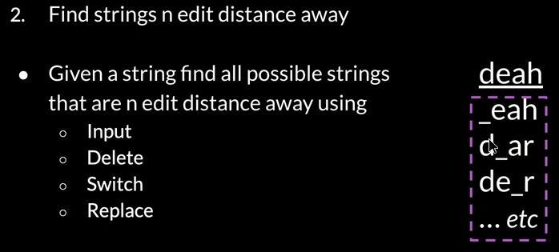
  <p><em>Figure 01: The four fundamental string edit operations (Insert, Delete, Switch, Replace).</em></p>
</div>

#### <a id="13-candidate-filtering-and-word-probabilities"></a>1.3 Candidate Filtering and Word Probabilities

The raw candidate set $E_1(w)$ and $E_2(w)$ contains many non-words. Filtering intersects candidates with vocabulary $\mathcal{V}$:
$$\mathcal{C}(w) = E(w) \cap \mathcal{V}$$

<div align="center">
  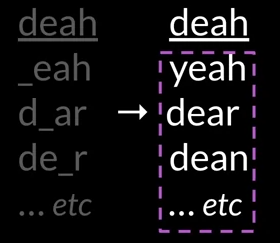
  <p><em>Figure 02: Candidate filtering through vocabulary lexicon intersection.</em></p>
</div>

The optimal suggestion is selected via Maximum Likelihood Estimation (MLE) based on corpus frequency:
$$P(w) = \frac{C(w)}{M}$$
where $C(w)$ is the count of word $w$ in the reference corpus and $M$ is the total token count.

<div align="center">
  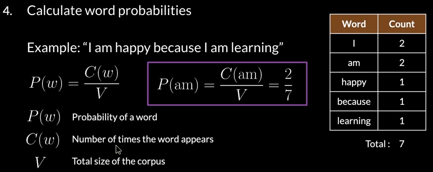
  <p><em>Figure 03: Computing word probabilities via corpus frequency distribution.</em></p>
</div>

#### <a id="14-minimum-edit-distance"></a>1.4 Minimum Edit Distance

Minimum Edit Distance quantifies the dissimilarity between two strings as the minimum cost required to transform source string $s_1$ into target string $s_2$.

<div align="center">
  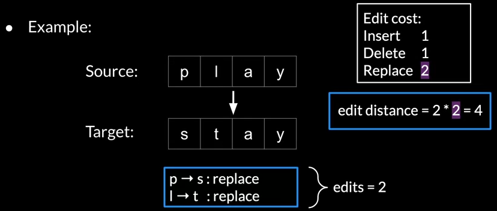
  <p><em>Figure 04: Cost assignments for primitive string edit operations.</em></p>
</div>

Under the standard Levenshtein distance formulation:

- **Insertion**: $\text{cost} = 1$
- **Deletion**: $\text{cost} = 1$
- **Replacement**: $\text{cost} = 2$ (or $0$ if characters match)

#### <a id="15-minimum-edit-distance-algorithm-levenshtein-dp"></a>1.5 Minimum Edit Distance Algorithm (Levenshtein DP)

We construct a 2D dynamic programming matrix $D$ of dimension $(|s_1| + 1) \times (|s_2| + 1)$, where $D[i, j]$ denotes the minimum edit distance between prefix $s_1[1 \dots i]$ and prefix $s_2[1 \dots j]$.

**Matrix Initialization**:
$$D[i, 0] = i \times \text{del\_cost}, \quad \forall i \in \{0, \dots, |s_1|\}$$
$$D[0, j] = j \times \text{ins\_cost}, \quad \forall j \in \{0, \dots, |s_2|\}$$

<div align="center">
  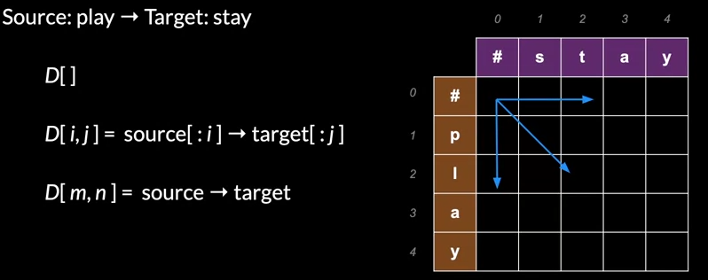
  <p><em>Figure 05: Dynamic programming distance matrix setup with source on rows and target on columns.</em></p>
</div>

**Recurrence Relation**:
$$D[i, j] = \min \begin{cases}
D[i - 1, j] + \text{del\_cost} \\
D[i, j - 1] + \text{ins\_cost} \\
D[i - 1, j - 1] + \begin{cases} 0 & \text{if } s_1[i] = s_2[j] \\ \text{rep\_cost} & \text{if } s_1[i] \neq s_2[j] \end{cases}
\end{cases}$$

<div align="center">
  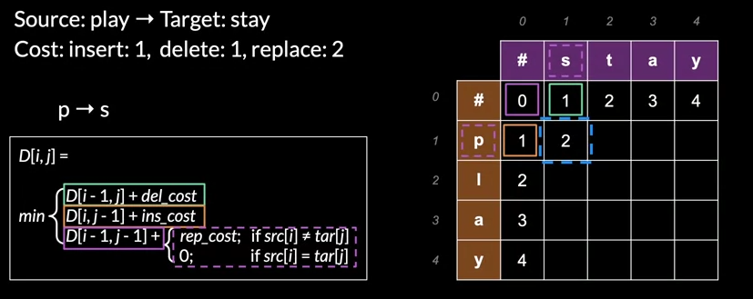
  <p><em>Figure 06: Recurrence relation for computing optimal cell distances and backpointers.</em></p>
</div>

---

### <a id="part-2-part-of-speech-tagging-hidden-markov-models"></a>Part 2: Part-of-Speech Tagging & Hidden Markov Models

#### <a id="21-part-of-speech-tagging-fundamentals"></a>2.1 Part-of-Speech Tagging Fundamentals
Part-of-Speech (POS) tagging is the process of assigning lexical syntactic categories (e.g., Noun `NN`, Verb `VB`, Adjective `JJ`, Preposition `IN`) to each word in a sequence:

<div align="center">
  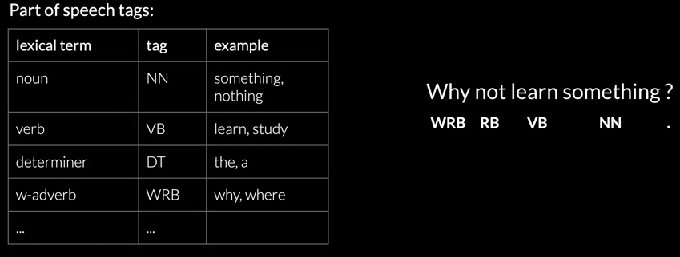
  <p><em>Figure 07: Syntactic POS tags assigned to an example sentence.</em></p>
</div>

POS tagging is a critical preliminary step in Named Entity Recognition (NER), Coreference Resolution, Syntactic Parsing, and Speech Recognition.

#### <a id="22-markov-chains-pos-state-graphs"></a>2.2 Markov Chains & POS State Graphs
A Markov Chain is a stochastic model describing a sequence of possible events where the probability of each event depends only on the state attained in the previous event (First-Order Markov Property):
$$P(t_k \mid t_1, t_2, \dots, t_{k-1}) = P(t_k \mid t_{k-1})$$

<div align="center">
  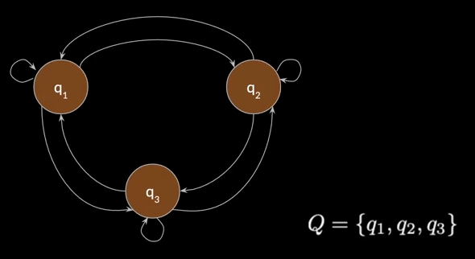
  <p><em>Figure 08: Directed graph representation of a Markov Chain state machine.</em></p>
</div>

When modeling POS tags as states, transition edges represent the probability of moving from tag $t_{i-1}$ to tag $t_i$:

<div align="center">
  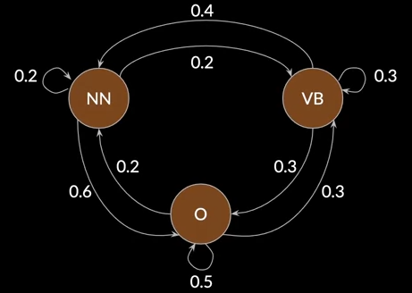
  <p><em>Figure 09: Directed graph representing transitions between parts of speech.</em></p>
</div>

The complete system forms a Transition Matrix $A \in \mathbb{R}^{(N+1) \times N}$, with an initial pseudo-state $\pi$ denoting the sentence start:

<div align="center">
  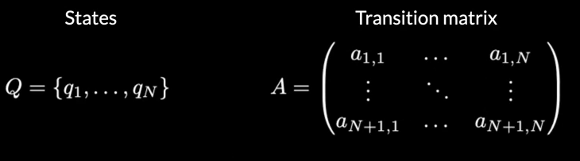
  <p><em>Figure 10: Row-stochastic POS transition matrix where row sums equal 1.</em></p>
</div>

#### <a id="23-hidden-markov-models-hmm-architecture"></a>2.3 Hidden Markov Models (HMM) Architecture
In a Hidden Markov Model:
- **Hidden States ($Q$)**: The true underlying POS tags $T = (t_1, t_2, \dots, t_K)$, which are not directly observable.
- **Observations ($O$)**: The sequence of emitted words $W = (w_1, w_2, \dots, w_K)$.
- **Transition Matrix ($A$)**: Governs the probability of transitioning between hidden states: $A_{i,j} = P(t_j \mid t_i)$.
- **Emission Matrix ($B$)**: Governs the probability that hidden state $t_i$ emits observable word $w_k$: $B_{i,k} = P(w_k \mid t_i)$.

<div align="center">
  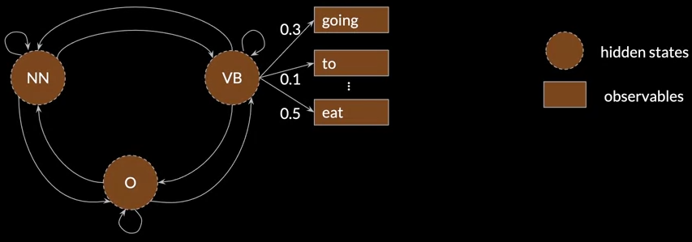
  <p><em>Figure 11: Hidden Markov Model emission probabilities matrix $B$ mapping hidden tags to observed words.</em></p>
</div>

#### <a id="24-transition-probability-matrix-a"></a>2.4 Transition Probability Matrix A
Transition probabilities are estimated from corpus co-occurrence frequencies:
$$C(t_{i-1}, t_i) = \text{Count of tag } t_{i-1} \text{ followed by tag } t_i$$

<div align="center">
  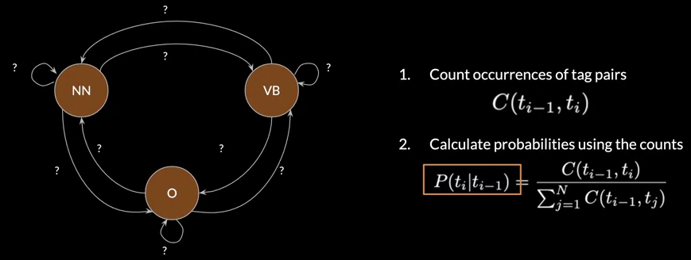
  <p><em>Figure 12: Frequency counting of adjacent POS tag pairs in the annotated corpus.</em></p>
</div>

The raw transition probability is:
$$A_{i,j} = P(t_j \mid t_i) = \frac{C(t_i, t_j)}{\sum_{k=1}^N C(t_i, t_k)}$$

<div align="center">
  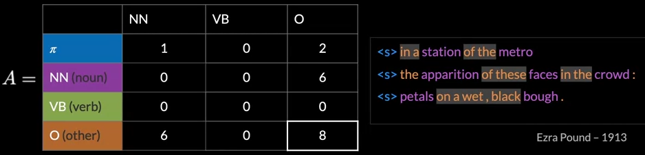
  <p><em>Figure 13: Maximum Likelihood Estimation of tag transition probabilities.</em></p>
</div>

To prevent zero probabilities for unseen tag transitions, we apply **Laplace Smoothing**:
$$A_{i,j} = \frac{C(t_i, t_j) + \epsilon}{\sum_{k=1}^N C(t_i, t_k) + N \cdot \epsilon}$$

<div align="center">
  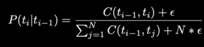
  <p><em>Figure 14: Laplace smoothing applied to avoid zero probabilities in transition matrix $A$.</em></p>
</div>

#### <a id="25-emission-probability-matrix-b"></a>2.5 Emission Probability Matrix B
The emission matrix $B$ captures the likelihood of a tag generating a specific word:
$$B_{i,k} = P(w_k \mid t_i) = \frac{C(t_i, w_k) + \epsilon}{\sum_{w \in \mathcal{V}} C(t_i, w) + V \cdot \epsilon}$$

<div align="center">
  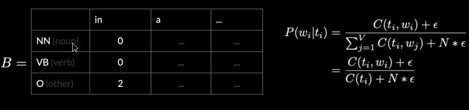
  <p><em>Figure 15: Co-occurrence frequency counting of tag-word pairs in the training corpus.</em></p>
</div>

#### <a id="26-the-viterbi-trellis-algorithm"></a>2.6 The Viterbi Trellis Algorithm
The Viterbi algorithm is a dynamic programming trellis decoder that finds the globally optimal sequence of hidden states $T^* = \arg\max_T P(T, W)$.

<div align="center">
  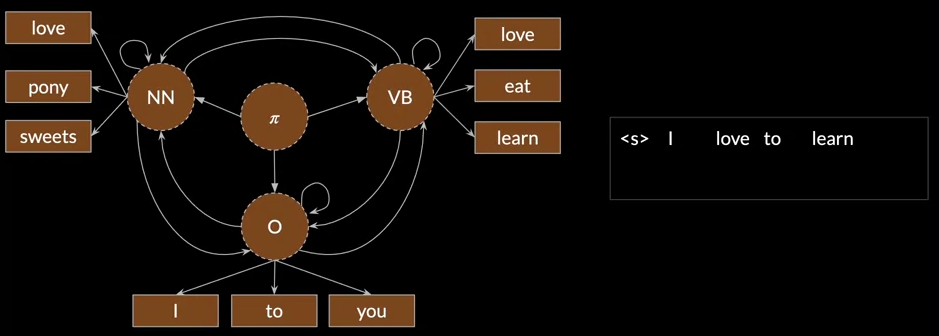
  <p><em>Figure 16: State trellis diagram illustrating forward optimal path propagation.</em></p>
</div>

The algorithm maintains two matrices:
- **Matrix $C \in \mathbb{R}^{N \times K}$**: Contains the optimal probability of the most likely hidden state sequence leading up to state $s_i$ at word $w_j$.
- **Matrix $D \in \mathbb{R}^{N \times K}$**: Stores the backpointers indicating the state index $k$ that maximized $C[i, j]$.

##### Step 1: Initialization
For the first token $w_1$ (column $j=0$):
$$C[i, 0] = \pi_i \times B_{i, w_1} = A_{0, i} \times B_{i, w_1}, \qquad D[i, 0] = 0$$

<div align="center">
  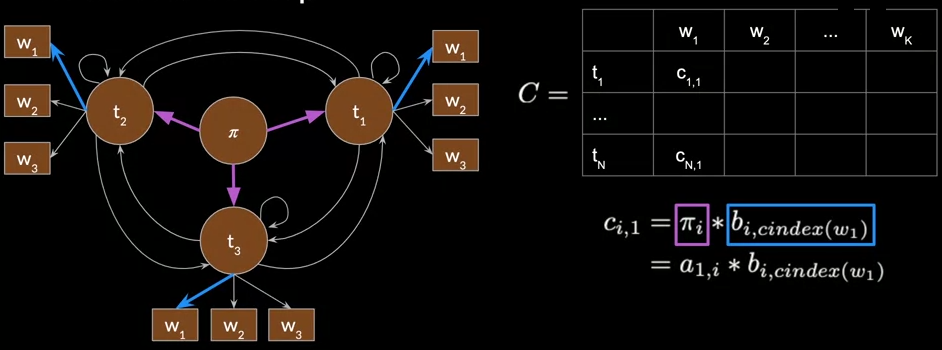
  <p><em>Figure 17: Initialization of probability matrix $C$ and backpointer matrix $D$.</em></p>
</div>

##### Step 2: Forward Pass
For each subsequent token $w_j$ ($j = 1 \dots K-1$) and state $s_i$:
$$C[i, j] = \max_{k=1 \dots N} \Big( C[k, j-1] \times A_{k, i} \times B_{i, w_j} \Big)$$

<div align="center">
  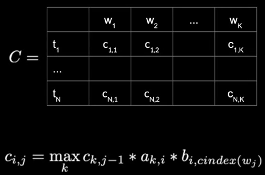
  <p><em>Figure 18: Forward recursion formula for computing cell values in matrix $C$.</em></p>
</div>

Record the backpointer index maximizing the path:
$$D[i, j] = \arg\max_{k=1 \dots N} \Big( C[k, j-1] \times A_{k, i} \times B_{i, w_j} \Big)$$

<div align="center">
  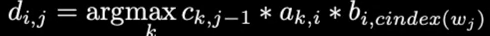
  <p><em>Figure 19: Storing the optimal preceding state index in matrix $D$.</em></p>
</div>

##### Step 3: Backward Pass (Traceback)
1. Find the best terminating state at column $K-1$:
   $$t_{K-1}^* = \arg\max_{i=1 \dots N} C[i, K-1]$$
2. Trace back recursively through matrix $D$:
   $$t_{j-1}^* = D[t_j^*, j], \quad \text{for } j = K-1, K-2, \dots, 1$$

To prevent arithmetic underflow when multiplying many small probabilities, computations are executed in **log space**:
$$\log C[i, j] = \max_k \Big( \log C[k, j-1] + \log A_{k, i} + \log B_{i, w_j} \Big)$$

<div align="center">
  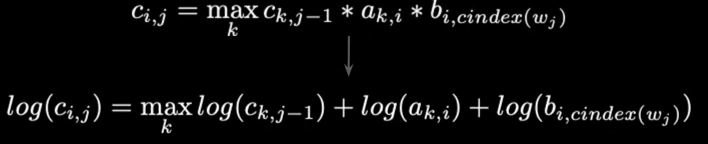
  <p><em>Figure 20: Log-probability formulation to prevent arithmetic underflow during trellis decoding.</em></p>
</div>

> [!NOTE]
> **Practical Engineering Intuitions:**
> - **Global Path Optimization vs. Greedy Decoding**: Selecting the locally highest-probability tag at each word independently fails because it ignores transition syntax. A word like *"run"* could be a noun or verb, but a preceding preposition like *"to"* heavily favors $A_{\text{TO}, \text{VB}}$ over $A_{\text{TO}, \text{NN}}$. The Viterbi trellis evaluates transition and emission likelihoods simultaneously to identify the globally optimal joint path.
> - **Log-Space Prevention of Floating-Point Underflow**: Multiplying $2K$ probabilities between $0$ and $1$ across a 30-word sentence produces tiny magnitudes ($< 10^{-60}$) that easily cause standard IEEE 754 float underflow. Computing in log space transforms products into additions ($\prod p_i \to \sum \log p_i$), maintaining full precision with zero numerical loss.

---

### <a id="part-3-autocomplete-n-gram-language-models"></a>Part 3: Autocomplete & N-Gram Language Models

#### <a id="31-statistical-language-models-n-gram-foundations"></a>3.1 Statistical Language Models & N-Gram Foundations
A language model computes the probability distribution over word sequences $P(w_1, w_2, \dots, w_m)$ and predicts upcoming tokens $P(w_m \mid w_1, \dots, w_{m-1})$.

An **$N$-gram** is a contiguous sequence of $N$ tokens:
- **Unigram ($N=1$)**: Single words (`teacher`, `drinks`)
- **Bigram ($N=2$)**: Two-word tuples (`the teacher`, `drinks tea`)
- **Trigram ($N=3$)**: Three-word tuples (`the teacher drinks`)

<div align="center">
  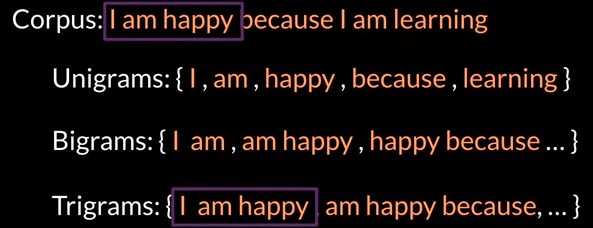
  <p><em>Figure 21: Definition and examples of Unigrams, Bigrams, and Trigrams.</em></p>
</div>

- **Unigram Probability**:
  $$P(w) = \frac{C(w)}{M}$$
  <div align="center">
    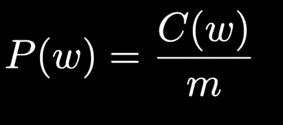
    <p><em>Figure 22: Unigram probability formula based on token relative frequency.</em></p>
  </div>

- **Bigram Conditional Probability**:
  $$P(w_n \mid w_{n-1}) = \frac{C(w_{n-1}, w_n)}{C(w_{n-1})}$$
  <div align="center">
    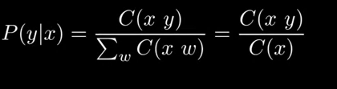
    <p><em>Figure 23: Bigram conditional probability formula.</em></p>
  </div>

- **General $N$-Gram Probability**:
  $$P(w_n \mid w_{n-N+1}^{n-1}) = \frac{C(w_{n-N+1}^{n})}{C(w_{n-N+1}^{n-1})}$$
  <div align="center">
    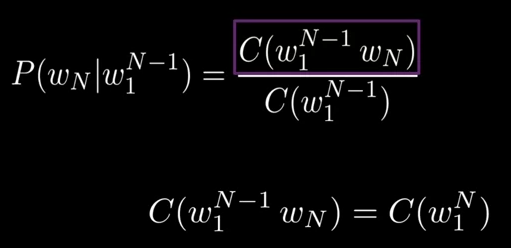
    <p><em>Figure 24: General N-Gram conditional probability formulation.</em></p>
  </div>

#### <a id="32-sequence-probabilities-the-markov-assumption"></a>3.2 Sequence Probabilities & The Markov Assumption
By the Chain Rule of Probability, the probability of an entire sentence is:
$$P(w_1, w_2, \dots, w_m) = \prod_{i=1}^m P(w_i \mid w_1, \dots, w_{i-1})$$

<div align="center">
  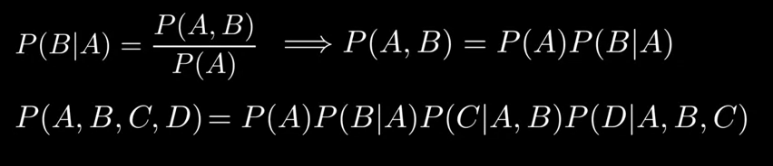
  <p><em>Figure 25: Full joint sequence probability decomposition via the probability chain rule.</em></p>
</div>

As sentences grow longer, exact prefix occurrences rapidly drop to zero. The **Markov Assumption** approximates history using only the preceding $N-1$ words:
$$P(w_n \mid w_1^{n-1}) \approx P(w_n \mid w_{n-N+1}^{n-1})$$

Under a Bigram model ($N=2$):
$$P(w_1, \dots, w_m) \approx \prod_{i=1}^m P(w_i \mid w_{i-1})$$

<div align="center">
  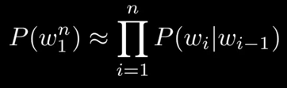
  <p><em>Figure 26: Bigram Markov assumption approximating sequence probabilities.</em></p>
</div>

#### <a id="33-sentence-boundary-tokens"></a>3.3 Sentence Boundary Tokens
To model sentence starts and endings correctly:
- Prepend $N-1$ start tokens `<s>` to each sentence.
- Append a single end token `</s>` to each sentence.

For a trigram model, each sentence begins with `<s> <s>` and ends with `</s>`.

#### <a id="34-n-gram-count-and-probability-matrices"></a>3.4 N-Gram Count and Probability Matrices
We structure $N$-grams into tabular matrices:
1. **Count Matrix**: Rows represent history prefixes $w_{n-N+1}^{n-1}$; columns represent target completions $w_n$.
   <div align="center">
     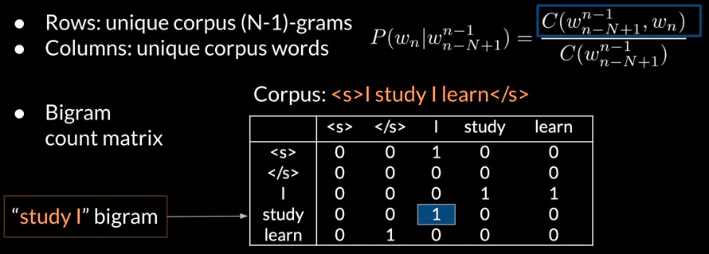
     <p><em>Figure 27: N-gram frequency count matrix indexing prefixes against target words.</em></p>
   </div>

2. **Probability Matrix**: Formed by row-normalizing count matrix values:
   $$P(w_n \mid w_{n-1}) = \frac{C(w_{n-1}, w_n)}{\sum_w C(w_{n-1}, w)}$$
   <div align="center">
     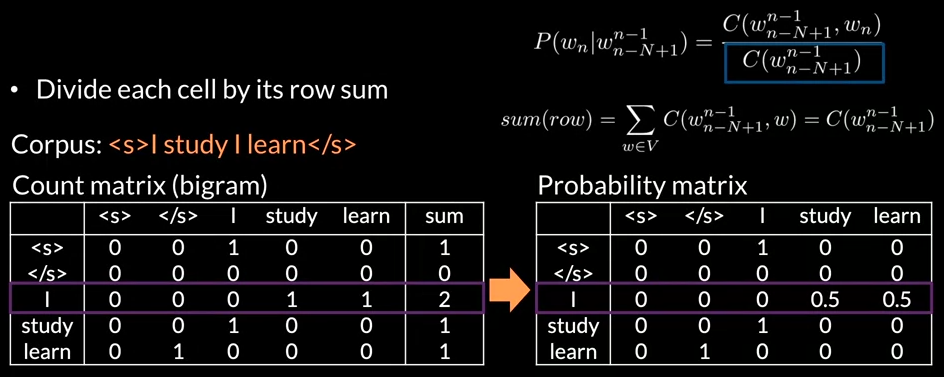
     <p><em>Figure 28: Row-normalized conditional probability matrix.</em></p>
   </div>

3. **Predictive Ranking**: Given input prefix $w_{n-1}$, sort row entries in descending order to output auto-complete suggestions:
   <div align="center">
     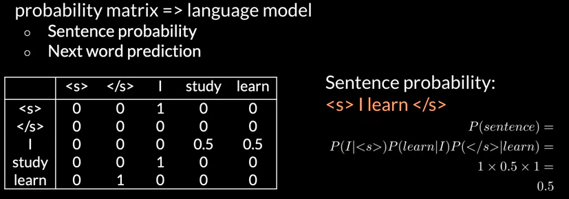
     <p><em>Figure 29: Ranking next-token candidates from probability matrix distributions.</em></p>
   </div>

#### <a id="35-language-model-evaluation-perplexity"></a>3.5 Language Model Evaluation & Perplexity
Corpora are partitioned into Train (80%), Validation (10%), and Test (10%) splits:

<div align="center">
  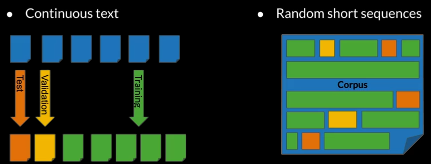
  <p><em>Figure 30: Continuous text and random sentence splitting strategies for corpus evaluation.</em></p>
</div>

**Perplexity ($PP$)** measures how well a probability model predicts a sample:
$$PP(W) = P(w_1, w_2, \dots, w_m)^{-\frac{1}{m}} = \sqrt[m]{\frac{1}{\prod_{i=1}^m P(w_i \mid w_{i-1})}}$$

<div align="center">
  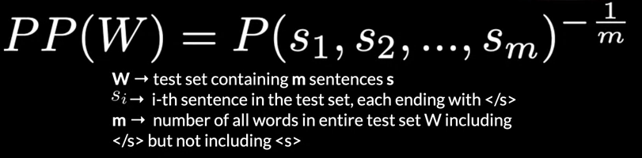
  <p><em>Figure 31: Perplexity evaluation metric definition. Lower perplexity indicates superior predictive performance.</em></p>
</div>

For a Bigram model:
$$PP(W) = \sqrt[m]{\prod_{i=1}^m \frac{1}{P(w_i \mid w_{i-1})}}$$

<div align="center">
  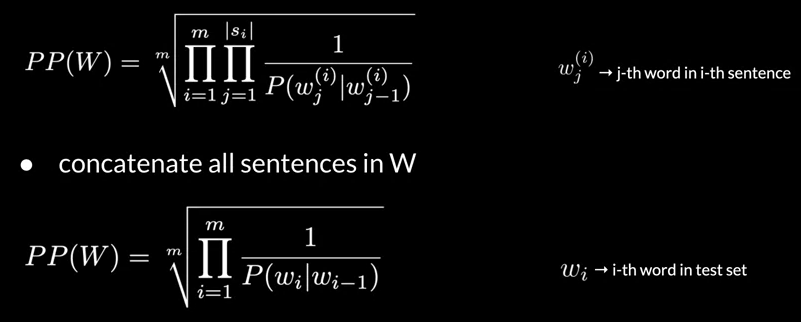
  <p><em>Figure 32: Perplexity formula specialized for bigram models.</em></p>
</div>

In practical implementations, **Log Perplexity** prevents underflow:
$$\log PP(W) = -\frac{1}{m} \sum_{i=1}^m \log_2 P(w_i \mid w_{i-1})$$

<div align="center">
  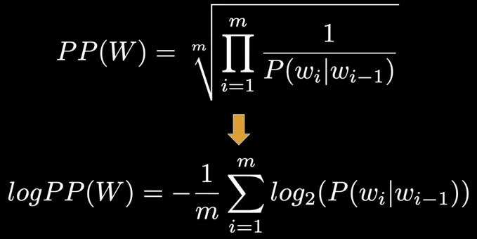
  <p><em>Figure 33: Log perplexity formula computed via summation of negative log probabilities.</em></p>
</div>

#### <a id="36-out-of-vocabulary-oov-words"></a>3.6 Out-of-Vocabulary (OOV) Words
Unseen tokens are mapped to a special token `<UNK>`. Vocabulary creation strategies:
- **Min-Frequency Threshold**: Replace any word appearing fewer than $f_{\min}$ times with `<UNK>`.
- **Top-$V$ Lexicon**: Retain top $V$ most frequent words; map all other words to `<UNK>`.

#### <a id="37-probability-smoothing-techniques"></a>3.7 Probability Smoothing Techniques
When an unseen $N$-gram appears in evaluation data, $C(w_{n-1}, w_n) = 0$, causing $P=0$ and perplexity to explode to $\infty$:

<div align="center">
  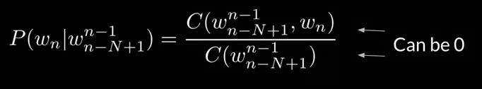
  <p><em>Figure 34: Zero-frequency sparsity challenges in empirical N-gram distributions.</em></p>
</div>

1. **Laplace (Add-One) Smoothing**:
   $$P_{\text{Laplace}}(w_n \mid w_{n-1}) = \frac{C(w_{n-1}, w_n) + 1}{C(w_{n-1}) + V}$$
   <div align="center">
     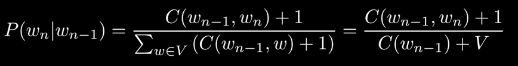
     <p><em>Figure 35: Laplace (add-one) smoothing formula.</em></p>
   </div>

2. **Add-$k$ (Lidstone) Smoothing**:
   $$P_{\text{Add-}k}(w_n \mid w_{n-1}) = \frac{C(w_{n-1}, w_n) + k}{C(w_{n-1}) + k \cdot V}, \quad 0 < k \le 1$$
   <div align="center">
     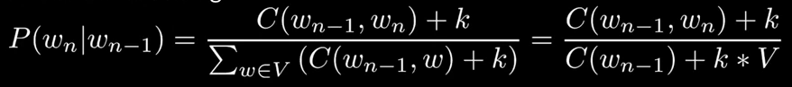
     <p><em>Figure 36: Add-k (Lidstone) smoothing formula.</em></p>
   </div>

3. **Backoff (e.g., Stupid Backoff)**:
   If an $N$-gram count is zero, back off to $(N-1)$-gram multiplied by a discount factor $\alpha = 0.4$:
   $$S(w_n \mid w_{n-1}) = \begin{cases} \frac{C(w_{n-1}, w_n)}{C(w_{n-1})} & \text{if } C(w_{n-1}, w_n) > 0 \\ 0.4 \times S(w_n) & \text{otherwise} \end{cases}$$

4. **Linear Interpolation**:
   Combines trigram, bigram, and unigram probabilities with weights summing to 1 ($\sum \lambda_i = 1$):
   $$\hat{P}(w_n \mid w_{n-2}, w_{n-1}) = \lambda_3 P(w_n \mid w_{n-2}, w_{n-1}) + \lambda_2 P(w_n \mid w_{n-1}) + \lambda_1 P(w_n)$$
   <div align="center">
     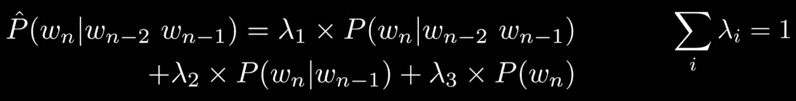
     <p><em>Figure 37: Linear interpolation combining multiple N-gram orders.</em></p>
   </div>

> [!NOTE]
> **Practical Engineering Intuitions:**
> - **Why Add-One (Laplace) Smoothing Is Too Aggressive in NLP**: In large vocabularies ($V > 30{,}000$), adding $1$ to every possible pair moves far too much probability mass from frequently observed words into the vast majority of zero-count pairs. Add-$k$ smoothing ($k \in [0.01, 0.05]$) or linear interpolation preserves real-world distributions far more accurately.
> - **Perplexity Intuition (The "Branching Factor")**: A language model with a perplexity of $50$ on a test corpus is as uncertain about the next token as if it were choosing uniformly at random from 50 equally probable words. Minimizing perplexity is mathematically equivalent to maximizing the likelihood of the test text.

---

### <a id="part-4-word-embeddings-continuous-bag-of-words-cbow"></a>Part 4: Word Embeddings & Continuous Bag-of-Words (CBOW)

#### <a id="41-word-representations-discrete-vs-distributed"></a>4.1 Word Representations: Discrete vs. Distributed
Traditional NLP used discrete integer indices or one-hot vectors:
- **Integer Encoding**: Assigns arbitrary index $i \in \{0, \dots, V-1\}$. Lacks semantic distance (e.g., 5 vs 6 implies no semantic relationship).
  <div align="center">
    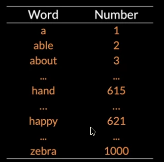
    <p><em>Figure 38: Arbitrary integer indexing of vocabulary words.</em></p>
  </div>

- **One-Hot Encoding**: Sparse vector $x \in \mathbb{R}^V$ with a single 1. All word vectors are orthogonal ($x_i^T x_j = 0$), failing to capture similarity.
  <div align="center">
    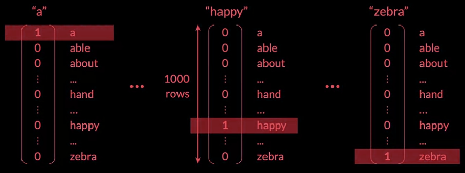
    <p><em>Figure 39: High-dimensional sparse one-hot vector representations.</em></p>
  </div>

- **Dense Word Embeddings**: Continuous vectors in $\mathbb{R}^N$ ($N \ll V$, typically $50 \le N \le 300$) where semantic proximity corresponds to geometric closeness (cosine similarity).
  <div align="center">
    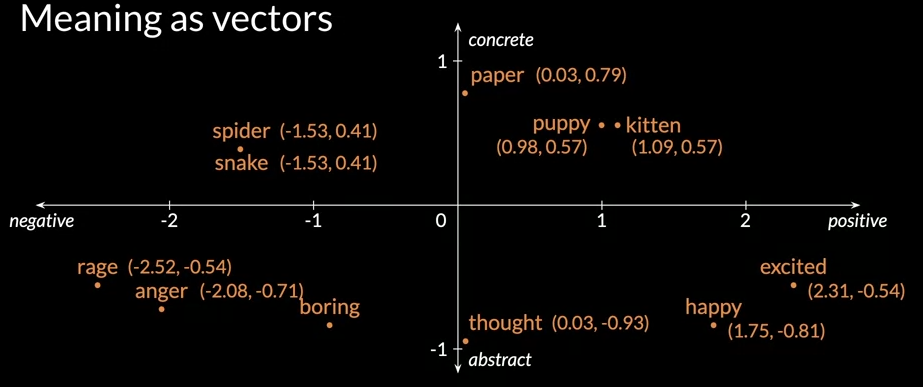
    <p><em>Figure 40: Low-dimensional continuous dense word embeddings.</em></p>
  </div>

#### <a id="42-word-embedding-learning-paradigms"></a>4.2 Word Embedding Learning Paradigms
To construct distributed representations, an unsupervised learning pipeline processes a large text corpus:

<div align="center">
  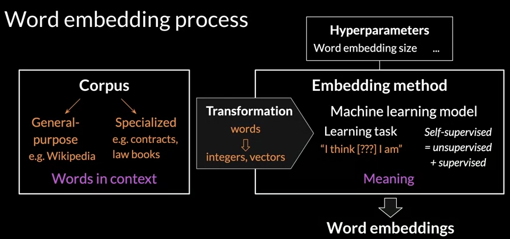
  <p><em>Figure 41: End-to-end unsupervised pipeline for learning dense word embeddings from raw text.</em></p>
</div>

Key embedding methods:
- **Word2Vec (Mikolov et al., 2013)**:
  - **CBOW (Continuous Bag-of-Words)**: Predicts center target word $w_t$ from surrounding context words.
  - **Skip-Gram with Negative Sampling (SGNS)**: Predicts context words given center word $w_t$.
- **GloVe (Pennington et al., 2014)**: Factorizes the log-count co-occurrence matrix.
- **FastText (Bojanowski et al., 2017)**: Learns subword character $n$-gram representations for robust out-of-vocabulary support.

#### <a id="43-continuous-bag-of-words-cbow-architecture"></a>4.3 Continuous Bag-of-Words (CBOW) Architecture
CBOW leverages the distributional hypothesis: words occurring in similar contexts share similar meanings.

<div align="center">
  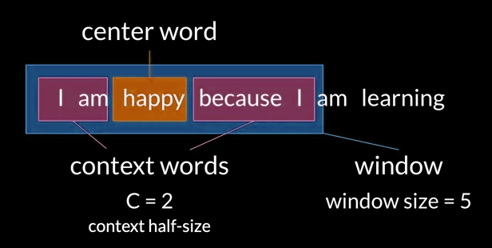
  <p><em>Figure 42: Context window of radius $C=2$ surrounding center target word $w_t$.</em></p>
</div>

A sliding window of radius $C$ moves across the corpus:

<div align="center">
  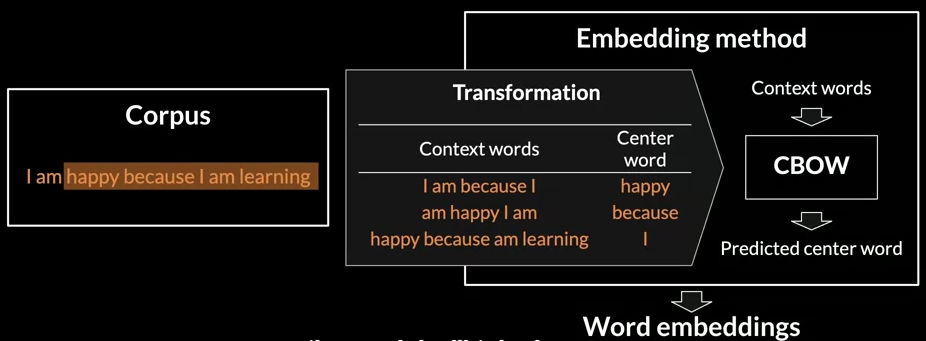
  <p><em>Figure 43: Sliding window extraction generating training observation pairs $(\bar{x}, y)$.</em></p>
</div>

#### <a id="44-data-cleaning-tokenization-sliding-windows"></a>4.4 Data Cleaning, Tokenization & Sliding Windows
Before vectorization, the text undergoes:
- Case normalization (lowercasing).
- Punctuation treatment (either tokenized as distinct tokens or stripped).
- Numeric abstraction (mapping digits to `<NUMBER>` or removing).
- Converting tokens into one-hot vectors and averaging context vectors:
  $$\bar{x} = \frac{1}{2C} \sum_{i \in \text{context}} x^{(i)}$$

<div align="center">
  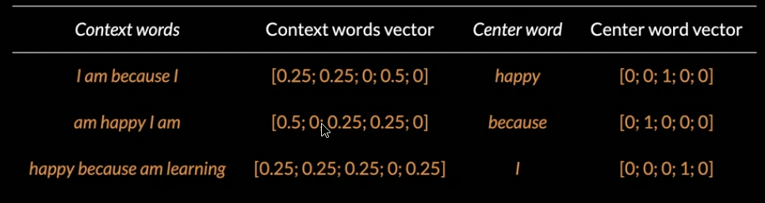
  <p><em>Figure 44: Prepared one-hot input context tensors and target one-hot vectors.</em></p>
</div>

#### <a id="45-tensor-dimensions-forward-propagation"></a>4.5 Tensor Dimensions & Forward Propagation
The CBOW neural network consists of an input layer, a single linear/ReLU hidden layer, and a softmax output layer:

<div align="center">
  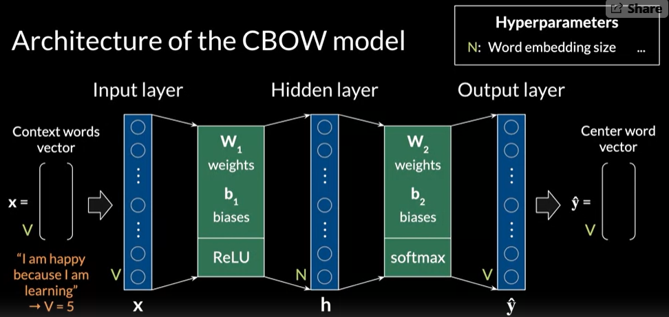
  <p><em>Figure 45: Two-layer shallow neural network architecture for Continuous Bag-of-Words.</em></p>
</div>

**Single Training Example Dimensions**:
- Average context vector: $\bar{x} \in \mathbb{R}^{V \times 1}$
- Input-to-hidden weights: $W_1 \in \mathbb{R}^{N \times V}$, bias $b_1 \in \mathbb{R}^{N \times 1}$
- Hidden layer activation: $h \in \mathbb{R}^{N \times 1}$
- Hidden-to-output weights: $W_2 \in \mathbb{R}^{V \times N}$, bias $b_2 \in \mathbb{R}^{V \times 1}$
- Output prediction: $\hat{y} \in \mathbb{R}^{V \times 1}$

<div align="center">
  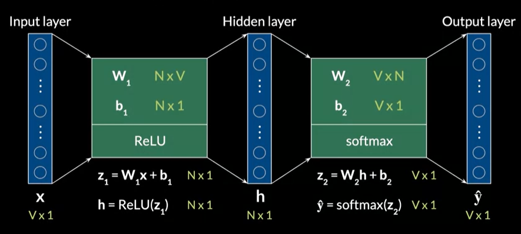
  <p><em>Figure 46: Tensor and parameter matrix dimensions for a single training input.</em></p>
</div>

**Mini-Batch Matrix Dimensions ($m$ examples)**:
- Batch input: $X \in \mathbb{R}^{V \times m}$
- Hidden activations: $H = \text{ReLU}(W_1 X + b_1) \in \mathbb{R}^{N \times m}$
- Output activations: $\hat{Y} = \text{Softmax}(W_2 H + b_2) \in \mathbb{R}^{V \times m}$

<div align="center">
  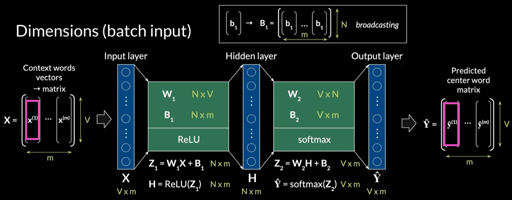
  <p><em>Figure 47: Parameter matrix and tensor dimensions during mini-batch operations.</em></p>
</div>

**Forward Propagation Equations**:
$$z_1 = W_1 \bar{x} + b_1, \qquad h = \text{ReLU}(z_1)$$
$$z_2 = W_2 h + b_2, \qquad \hat{y} = \text{Softmax}(z_2)$$

<div align="center">
  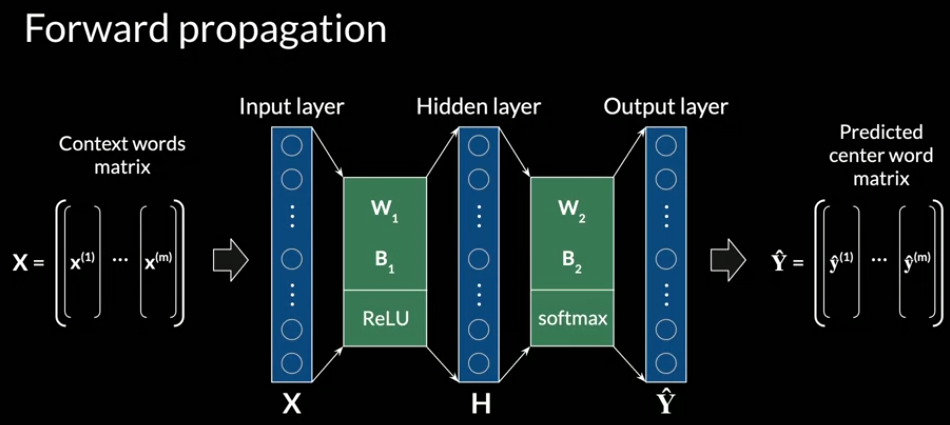
  <p><em>Figure 52: Mathematical forward propagation equations for CBOW.</em></p>
</div>

<div align="center">
  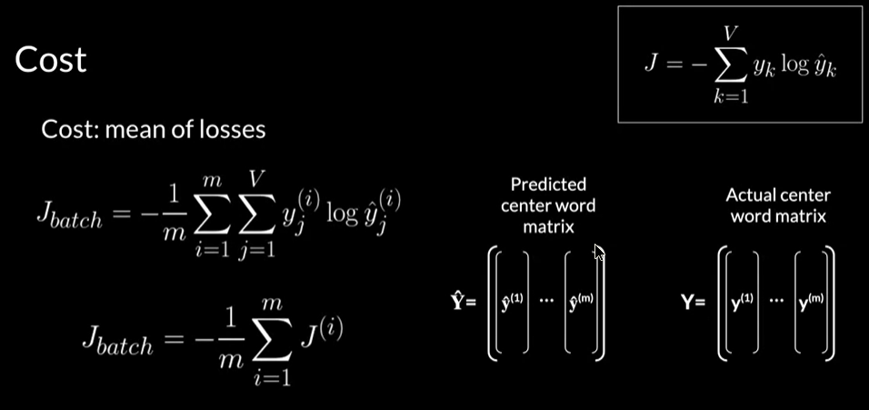
  <p><em>Figure 53: Vectorized forward propagation equations for batch execution.</em></p>
</div>

#### <a id="46-activation-functions-cross-entropy-cost"></a>4.6 Activation Functions & Cross-Entropy Cost
- **ReLU (Rectified Linear Unit)**:
  $$\text{ReLU}(z) = \max(0, z)$$
  <div align="center">
    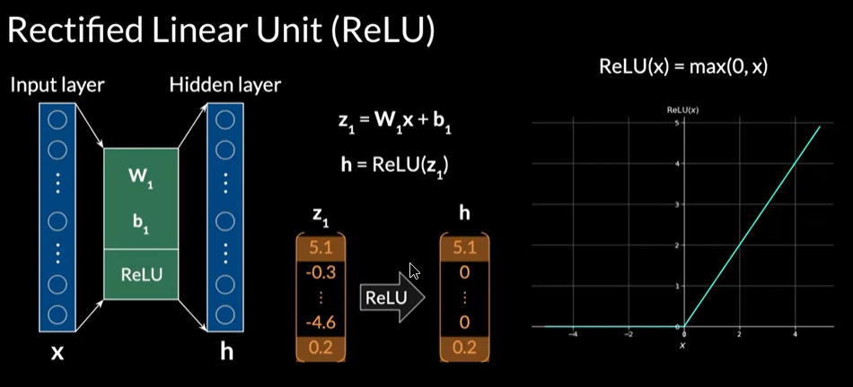
    <p><em>Figure 48: ReLU activation function graph and definition.</em></p>
  </div>

- **Softmax Activation**:
  $$\hat{y}_i = \frac{e^{z_{2, i}}}{\sum_{j=1}^V e^{z_{2, j}}}$$
  <div align="center">
    
    <p><em>Figure 49: Softmax function converting raw logits into normalized probability distribution.</em></p>
  </div>

- **Cross-Entropy Loss (Single Example)**:
  $$\mathcal{L}(\hat{y}, y) = -\sum_{i=1}^V y_i \log \hat{y}_i = -\log \hat{y}_{\text{target}}$$
  <div align="center">
    
    <p><em>Figure 50: Cross-entropy loss formulation for single training pair.</em></p>
  </div>

- **Batch Cost Function**:
  $$J = -\frac{1}{m} \sum_{k=1}^m \sum_{i=1}^V y_i^{(k)} \log \hat{y}_i^{(k)}$$
  <div align="center">
    
    <p><em>Figure 51: Mean batch cross-entropy cost function over $m$ observations.</em></p>
  </div>

#### <a id="47-backpropagation-mini-batch-gradient-descent"></a>4.7 Backpropagation & Mini-Batch Gradient Descent
Gradients are computed via the chain rule backwards from output to input:
$$\frac{\partial J}{\partial z_2} = \hat{Y} - Y$$
$$\frac{\partial J}{\partial W_2} = \frac{1}{m} \frac{\partial J}{\partial z_2} H^T, \qquad \frac{\partial J}{\partial b_2} = \frac{1}{m} \sum_{k=1}^m \frac{\partial J}{\partial z_2^{(k)}}$$
$$\frac{\partial J}{\partial h} = W_2^T \frac{\partial J}{\partial z_2}$$
$$\frac{\partial J}{\partial z_1} = \frac{\partial J}{\partial h} \odot \mathbb{I}(z_1 > 0)$$
$$\frac{\partial J}{\partial W_1} = \frac{1}{m} \frac{\partial J}{\partial z_1} X^T, \qquad \frac{\partial J}{\partial b_1} = \frac{1}{m} \sum_{k=1}^m \frac{\partial J}{\partial z_1^{(k)}}$$

<div align="center">
  
  <p><em>Figure 54: Analytical backpropagation gradient derivations.</em></p>
</div>

**Parameter Update**:
$$W_1 := W_1 - \alpha \frac{\partial J}{\partial W_1}, \qquad b_1 := b_1 - \alpha \frac{\partial J}{\partial b_1}$$
$$W_2 := W_2 - \alpha \frac{\partial J}{\partial W_2}, \qquad b_2 := b_2 - \alpha \frac{\partial J}{\partial b_2}$$

<div align="center">
  
  <p><em>Figure 55: Gradient descent parameter updates with learning rate $\alpha$.</em></p>
</div>

#### <a id="48-extracting-dense-word-vectors"></a>4.8 Extracting Dense Word Vectors
Once trained, word embeddings can be extracted from network weights via three strategies:
1. **From $W_1 \in \mathbb{R}^{N \times V}$**: Each column $j$ corresponds to the embedding vector $v_{w_j} \in \mathbb{R}^N$.
   <div align="center">
     
     <p><em>Figure 56: Extracting word vectors from columns of weight matrix $W_1$.</em></p>
   </div>

2. **From $W_2 \in \mathbb{R}^{V \times N}$**: Each row $i$ corresponds to the embedding vector $u_{w_i} \in \mathbb{R}^N$.
   <div align="center">
     
     <p><em>Figure 57: Extracting word vectors from rows of weight matrix $W_2$.</em></p>
   </div>

3. **Average $W_3 = \frac{1}{2}(W_1 + W_2^T)$**: Averaging both representations frequently yields the highest quality representations:
   <div align="center">
     
     <p><em>Figure 58: Extracting word embeddings via the symmetric mean $W_3 = (W_1 + W_2^T) / 2$.</em></p>
   </div>

#### <a id="49-evaluating-word-vector-quality"></a>4.9 Evaluating Word Vector Quality
Embedding evaluation is conducted through two paradigms:
- **Intrinsic Evaluation**: Tests geometric relationships directly within the vector space.
  - *Word Analogies*: Testing vector arithmetic: $\vec{v}_{\text{king}} - \vec{v}_{\text{man}} + \vec{v}_{\text{woman}} \approx \vec{v}_{\text{queen}}$.
    <div align="center">
      
      <p><em>Figure 59: Semantic analogy arithmetic tests in continuous vector space.</em></p>
    </div>
  - *Clustering & Dimensionality Reduction (PCA)*: Projecting vectors into 2D/3D space to visually verify semantic clustering.
    <div align="center">
      
      <p><em>Figure 60: PCA projection pipeline reducing dimensions for cluster visualization.</em></p>
    </div>
    <div align="center">
      
      <p><em>Figure 61: 2D visualization verifying semantic proximity among related word clusters.</em></p>
    </div>
- **Extrinsic Evaluation**: Evaluates word vectors as feature representations in downstream NLP models (e.g., Sentiment Classification, Named Entity Recognition, POS Tagging) measured by $F_1$-score or accuracy.

> [!NOTE]
> **Practical Engineering Intuitions:**
> - **The Symmetric Mean Advantage**: Averaging input weight columns $W_1$ and output weight rows $W_2^T$ ($W_3 = \frac{1}{2}(W_1 + W_2^T)$) regularizes individual weight variance, smoothing out stochastic gradient noise and consistently producing the highest-quality cosine similarities.
> - **Linear Vector Analogies**: Continuous vector spaces organize semantic concepts geometrically. Because displacement vectors encode relationships, vector arithmetic mirrors relational reasoning: $\vec{v}_{\text{Paris}} - \vec{v}_{\text{France}} + \vec{v}_{\text{Germany}} \approx \vec{v}_{\text{Berlin}}$ or $\vec{v}_{\text{walking}} - \vec{v}_{\text{walk}} + \vec{v}_{\text{swim}} \approx \vec{v}_{\text{swimming}}$.

---

## <a id="license"></a><a id="license-acknowledgments"></a>📄 License

This repository is licensed under the **MIT License**. See the [`LICENSE`](LICENSE) file for complete details.

---

## 🔗 Connect with Me

<div align="center">

[](https://mohdfaizy.vercel.app)
[](https://www.linkedin.com/in/mohd-faizy/)
[](https://github.com/mohd-faizy)
[](https://www.credly.com/users/mohd-faizy)
[](https://twitter.com/F4izy)
[](https://ai.stackexchange.com/users/36737/faizy)

</div>